<div align="center">


<a href="https://r19.io"></a>
<a href="https://github.com/nullbyter19?tab=followers"></a>
<a href="https://github.com/nullbyter19?tab=repositories"></a>


</div>

<br/>

```console
$ whoami
milton_silva — security researcher · lisbon, pt

$ cat focus.txt
offensive security · av/edr evasion · payload delivery · exploit development

$ ls ~/current
umbra/   deadbyte/   deaddrop/   php2shell/   umbra-microsoft-lure/
```

> Security researcher focused on **evasion, payload delivery and bypassing AV/EDR**.
> I build and publish proof of concepts and offensive techniques — from indirect
> syscalls and in-memory execution to exploit development and the cryptography
> that keeps a C2 channel quiet. Everything here is for authorized testing and
> research.

<br/>

## Focus areas

|  |  |
|:--|:--|
| **Red Team Tooling** <br/><sub>C2 frameworks, loaders, stagers and operator tooling — end to end, in Go</sub> | **AV/EDR Evasion** <br/><sub>indirect syscalls, PEB walking, export-table parsing, in-memory execution</sub> |
| **Payload Delivery** <br/><sub>HTML smuggling, Cloudflare Tunnel fronts, staged and fileless execution</sub> | **Exploit Development** <br/><sub>white-box auditing, use-after-free, XXE, SSTI, auth bypass — with PoC</sub> |
| **Applied Cryptography** <br/><sub>X3DH + Double Ratchet, X25519/HKDF, AES-256-GCM, signed receipts</sub> | **Detection Engineering** <br/><sub>simulated ransomware and EDR exercises that train defenders</sub> |

<br/>

## Tech stack

**Languages**


**Offensive tooling**


**Platforms & runtime**


**Data**


<br/>

## Certifications

<p align="center"><sub><strong>OFFSEC &nbsp;·&nbsp; SECOPS GROUP &nbsp;·&nbsp; INE &nbsp;·&nbsp; ISC² &nbsp;·&nbsp; EXIN</strong></sub></p>

<p align="center"><a href="https://credentials.offsec.com/7d7a2a35-69ae-4fd2-967d-517effdda8b9"></a> <a href="https://www.credential.net/97ed8d75-576e-40fa-9809-440661e9a579"></a> <a href="https://www.credential.net/5205590d-3373-4481-a403-9cf0e4f71780"></a>  <a href="https://certs.ine.com/4b4c9750-2288-42e0-87c6-b9b11ba6ebf7"></a> <a href="https://www.credly.com/badges/432a5f77-1bde-4f94-b71b-097db490a303">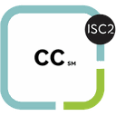</a> <a href="https://mylogin.exin.nl/AppPool_2/polarserver.asp?FrameSet=Minimal&amp;ToolName=CertificateCheckTool&amp;Framed=1&amp;LastName=Araujo%20da%20Silva&amp;CertificateNumber=6187270.20735991&amp;ModuleID=630590&amp;SID=92BCF1ABE37576E67A57DF674FC47029&amp;PageID=0">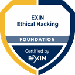</a></p>

<p align="center"><sub><strong>EC-COUNCIL</strong></sub></p>

<p align="center"><a href="https://aspen.eccouncil.org/VerifyBadge?type=certification&amp;a=fOWjie+8/y/XpwLGbsp/KEZU7wEp8t0WwzLRjvwUu+U=">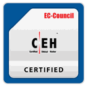</a> <a href="https://aspen.eccouncil.org/VerifyBadge?type=certification&amp;a=7Dzjgyxw/lR7AnYbsf7BOOT/sEN5uOssdcg0cKBqoFM=">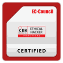</a> <a href="https://aspen.eccouncil.org/VerifyBadge?type=certification&amp;a=7Dzjgyxw/lR7AnYbsf7BOKT6/3d8fylb/QUdpEbNJ3s=">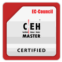</a> <a href="https://aspen.eccouncil.org/VerifyBadge?type=certification&amp;a=AZWstf7MXKV5gxza2IkgSD5cnfvNo2XLGXzqNJR4xNI="></a> <a href="https://aspen.eccouncil.org/VerifyBadge?type=certification&amp;a=+4mwyQBjVET2Vc0k3B6VM8tolk+GQ/sbzjGk375pYOI="></a> <a href="https://aspen.eccouncil.org/VerifyBadge?type=certification&amp;a=f6npL0iMv70SFJFRoM4BT+acNPRx/YDWQdewnk84mmk="></a> <a href="https://aspen.eccouncil.org/VerifyBadge?type=certification&amp;a=/sayMjfesDdYo3KdlgtnWbB/psiHs1AZvs6Z/Zwh/zc=">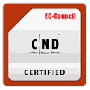</a> <a href="https://aspen.eccouncil.org/VerifyBadge?type=certification&amp;a=NNGWOyHMUCAQ89B9bRKYm0TQWdotaq+dflIAZogAn6o=">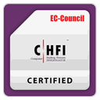</a> <a href="https://aspen.eccouncil.org/VerifyBadge?type=certification&amp;a=ABuMFHxpCJcjzFIX5aQfm43zJpiVnY2/LgQVTra9WNs="></a> <a href="https://aspen.eccouncil.org/VerifyBadge?type=certification&amp;a=BqTu2sjG6We+HtGyjDeBjt1foj5dmXVKJR6Ya7g1+Es="></a> <a href="https://aspen.eccouncil.org/VerifyBadge?type=certification&amp;a=QXg+Y+T1JJH8WpQRqHqT2v16BewdhreBXENEwkvN5+E="></a> <a href="https://aspen.eccouncil.org/VerifyBadge?type=certification&amp;a=CBRGzRAdjdVHrQPH6G0nakVzrc/N9g/+ja720LucMwc="></a> <a href="https://aspen.eccouncil.org/VerifyBadge?type=certification&amp;a=wAYnH3V6ZuIBVJ+5RF+nXzwGmfH2vodExfSLDPE7z+w="></a></p>

<p align="center"><sub><strong>COMPTIA</strong></sub></p>

<p align="center"><a href="https://www.credly.com/badges/049f6730-aed0-4016-be59-e56c879bb4ab">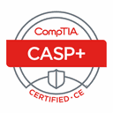</a> <a href="https://www.credly.com/badges/75b3e651-ccd8-4859-a930-40c190fea341"></a> <a href="https://www.credly.com/badges/5a74673a-b126-4c94-b3d4-0d6ef8126808">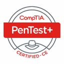</a> <a href="https://www.credly.com/badges/1cf59010-7890-4c76-990b-ad765ed9a476">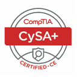</a> <a href="https://www.credly.com/badges/70731abc-c4bc-4dda-9278-97fff2577467"></a> <a href="https://www.credly.com/badges/aee4bd57-2985-43db-8705-0afba1dc9041"></a> <a href="https://www.credly.com/badges/7dfc7aa1-1342-475b-bfb5-755ed5fd5444"></a> <a href="https://www.credly.com/badges/48c6042a-81d3-4aaa-a581-99f2e6f03427"></a> <a href="https://www.credly.com/badges/b5df0a51-8a7c-498d-848c-b572c820eace">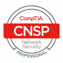</a> <a href="https://www.credly.com/badges/676f953f-dfed-408c-ab23-cd740eece35f">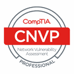</a></p>

<p align="center"><sub><strong>MICROSOFT</strong></sub></p>

<p align="center"><a href="https://www.credly.com/badges/436f060c-7aa9-4883-8484-a5f3de51b6b6"></a> <a href="https://www.credly.com/badges/9dfd4a67-39aa-40a9-9deb-fb25243fc1cc"></a> <a href="https://www.credly.com/badges/8d59c7a3-3b05-4199-a6cd-c402e74579ad"></a> <a href="https://www.credly.com/badges/3b226cf3-f9bd-450e-a0b3-f0935240edcb"></a></p>

<p align="center"><sub>34 certifications — full credential set at <a href="https://r19.io/whoami"><strong>r19.io/whoami</strong></a></sub></p>

<br/>

## Activity & languages

<div align="center">


<br/>


</div>

<br/>

## Featured work

<div align="center">

<a href="https://github.com/nullbyter19/umbra"></a>
<a href="https://github.com/nullbyter19/deadbyte"></a>
<br/>
<a href="https://github.com/nullbyter19/deaddrop"></a>
<a href="https://github.com/nullbyter19/php2shell"></a>

</div>

### What each one covers

| Project | What it does | Stack |
|:--|:--|:--|
| **[umbra](https://github.com/nullbyter19/umbra)** | Indirect-syscall C2 framework in pure Go: PEB walk, SSN resolution, `syscall;ret` gadget donation, own HTTPS C2 with AES-256-GCM envelope, loaders and tunnel-based delivery | `Go` `x86-64` `PowerShell` |
| **[deadbyte](https://github.com/nullbyter19/deadbyte)** | Ransomware **simulation** framework for EDR/IR exercises: X25519 + HKDF + AES-256-GCM per file, key sealing, web panel and a recovery tool | `Go` `SQL` |
| **[deaddrop](https://github.com/nullbyter19/deaddrop)** | Zero-knowledge E2EE messenger: X3DH + Double Ratchet, encrypted local vault, ephemeral "drops" and server-signed deletion receipts | `TypeScript` `React` `Node` |
| **[php2shell](https://github.com/nullbyter19/php2shell)** | PHP use-after-free research, exploit chain and a disposable Docker lab (CVE-2026-109618 / CVE-2026-109619) | `PHP` `Python` `Shell` |
| **[umbra-microsoft-lure](https://github.com/nullbyter19/umbra-microsoft-lure)** | Microsoft 365 sign-in lure and credential-capture delivery module built on the umbra core | `Go` `HTML` |
| **[cve-2018-10933](https://github.com/nullbyter19/cve-2018-10933)** | libssh server authentication bypass — forged `SSH2_MSG_USERAUTH_SUCCESS` over a real channel | `Python` |
| **[vcenter-vmdir-srp-bypass](https://github.com/nullbyter19/vcenter-vmdir-srp-bypass)** | vCenter VMDir SRP authentication bypass PoC | `Python` |
| **[cve-2016-0287](https://github.com/nullbyter19/cve-2016-0287)** | IBM i Access cached credential disclosure — 16-bit RA1470/RA1471 key recovery | `Python` |
| **[xor-donut](https://github.com/nullbyter19/xor-donut)** | XOR encoder for Donut shellcode with a small C loader | `Python` `C` |

<br/>

## Currently

```yaml
building:   umbra  ·  deadbyte  ·  deaddrop
writing:    PoCs, technique notes and lab runbooks (English, reproducible, verifiable)
```

<br/>

## Connect

<div align="center">

<a href="https://r19.io"></a>
<a href="https://github.com/nullbyter19"></a>

</div>

<br/>

<div align="center">
<sub>All tooling in this profile is published for <strong>authorized security testing, research and education</strong>.<br/>
Use it only against systems you own or have written permission to test.</sub>
</div>
